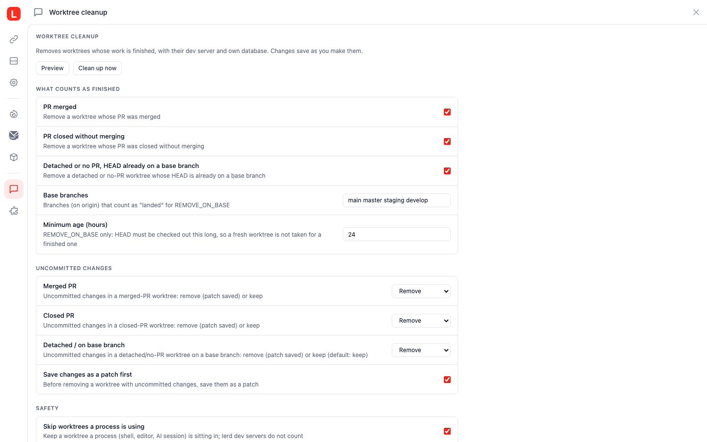

# lerd worktree-cleanup

A [lerd](https://github.com/lerd-env/lerd) plugin that removes finished git
worktrees, with their dev server and their own database, by hand or on a
schedule, following rules you choose.

Every worktree of a proxy site runs its own dev server (a file watcher) and a
Laravel worktree can carry its own database, so finished worktrees pile up and
keep `fseventsd` busy. "Finished" means: its PR was merged, its PR was closed,
or (detached / no PR) its HEAD is already on a base branch and has been for a
day. Worktrees a process is sitting in, or that lerd saw recent traffic on, are
kept. Uncommitted changes are saved as a patch before removal, or the worktree
is kept, per your settings.



```
lerd plugin install https://github.com/bikramtuladhar/lerd-plugin-worktree-cleanup
```

Usage, every setting and the required tools: [DOCS.md](DOCS.md).

## What it adds

- A dashboard page, **Worktree cleanup**: every setting as a toggle, the
  schedule, a tool check, Preview (dry run) and Clean up now.
- Commands `worktree-cleanup:run`, `:config`.
- A schedule, `cleanup`, that lerd runs every 15 minutes once you allow it;
  the plugin acts only once `SCHEDULE_EVERY` has passed.
- A site command, **Clean up finished worktrees**, for one site.
- An MCP tool, `worktree-cleanup_run`, plus a skill telling assistants to dry
  run first.
- A loopback-only API endpoint the page uses.

## What it reads

- lerd's `/api/sites` (sites, their worktrees, branch, idle state and whether
  a worktree has its own database).
- Each site's git repository: `git fetch origin`, worktree status, whether HEAD
  is on a base branch.
- The working folder of running processes (`ps`, `lsof`), to skip worktrees in use.

## What it changes

- Removes finished worktrees with `lerd worktree remove` (and `--force` only
  when your rules say to remove one with uncommitted changes).
- Drops a worktree's own database with `lerd db:share` before removing it.
- Writes only to its data folder: `config.env`, `cleanup.log`, `patches/`,
  `last-scheduled-run` (lerd writes `schedule.log` there too).
- **Schedule (off until you allow it):** lerd asks at install, or turn it on
  with the Schedule switch on the plugin's card or
  `lerd plugin schedule worktree-cleanup on`. lerd has no "PR merged" event, so
  this is how "clean up after a merge" happens without you running it.

## What it sends

- GitHub, through the `gh` CLI you are logged into: for each site's `origin`
  repository, its pull requests (head branch, state, number), and a search by
  commit SHA for a detached HEAD. Nothing else leaves the machine.
- lerd's own API: `/api/sites` and, only after a scheduled run removes
  something, a dashboard notification (`NOTIFY`).

## Requirements

macOS or Linux, lerd 1.39+ (for schedules), `gh` (logged in), `git`, `jq`,
`curl`, `lsof`.

## License

MIT
